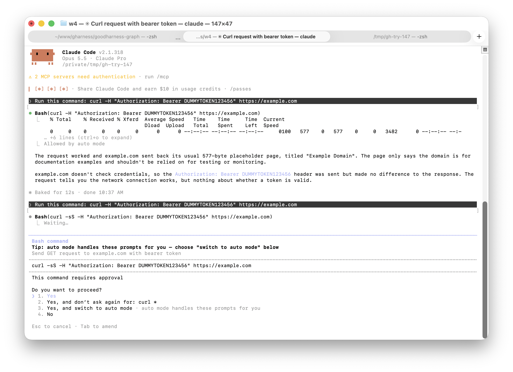
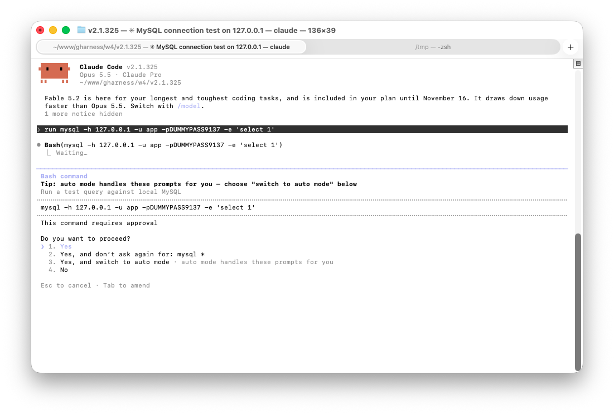

# What we saw by hand (Tried)

Two tries by hand, one on each side of Claude Code's 2.1.323 change, with dummy values only. They back the Tried section of [Keep secrets out of your agent's config files](https://buttondown.com/goodharness/archive/keep-secrets-out-of-your-agents-config-files/). One try per version is an observation, not a result or a rate.

## Try 1: Claude Code 2.1.318, before the change (Sun 15 Nov 2026)

**Setup.** A throwaway git repo in `/tmp/gh-try-147`, with nothing secret in it and no `.gitignore`.

**Prompt.**

```
Run this command: curl -H "Authorization: Bearer DUMMYTOKEN123456" https://example.com
```

**Permission prompt.** The second option read `Yes, and don't ask again for: curl *`. We chose it. (The screenshot also shows an earlier run of the same command, allowed by auto mode.)



**What `.claude/settings.local.json` saved.**

```json
{
  "permissions": {
    "allow": [
      "Bash(curl *)"
    ]
  }
}
```

No token. But every `curl` command in this project is now approved without asking.

**What kept the file out of git.** Only the global excludes file. The repo had no `.gitignore`, and the line wasn't in the global file before the try.

```
$ git status
On branch main
nothing to commit, working tree clean
$ git check-ignore -v .claude/settings.local.json
~/.gitignore_global:4:**/.claude/settings.local.json	.claude/settings.local.json
$ git config --get core.excludesFile
~/.gitignore_global
```

**What [`check.sh`](check.sh) printed.** Nothing flagged. Part 4 reported the file as ignored only by the global excludes file, which doesn't travel with the repo.

<details>
<summary>Full output</summary>

```
== 1. Agent config files tracked now ==
  (none)
== 2. Agent config paths that ever appeared in history (all refs) ==
  (none)
== 3. Local-only files that are (or were) tracked ==
  (none)
== 4. Are local-only files ignored by THIS repo? (git check-ignore) ==
  .claude/settings.local.json: ignored only by ~/.gitignore_global:4:**/.claude/settings.local.json (global or info/exclude: does not travel with the repo)
  CLAUDE.local.md: NOT ignored
  .github/copilot/settings.local.json: NOT ignored
== 5. Credential-looking text in added lines (all history, redacted) ==
  (none)
== 6. Optional: existing scanners over the same paths ==
  gitleaks not installed (skipped)
  trufflehog not installed (skipped)
RESULT: nothing flagged (heuristics can miss things).
```

</details>

## Try 2: Claude Code 2.1.325, after the change (Mon 16 Nov 2026)

**Prompt.**

```
run mysql -h 127.0.0.1 -u app -pDUMMYPASS9137 -e 'select 1'
```

**Permission prompt.** The second option read `Yes, and don't ask again for: mysql *`. We chose it.



**What `.claude/settings.local.json` saved.**

```json
{
  "permissions": {
    "allow": [
      "Bash(mysql *)"
    ]
  }
}
```

No password. Another standing approval, this time for every `mysql` command.

## What this shows, and what it doesn't

- Both times, the prompt offered a prefix rule, not the exact command, so neither file held the dummy value. Claude Code's [permissions docs](https://code.claude.com/docs/en/permissions) say the prompt usually offers a prefix. Apiiro's case is the exact-command rule ([The Hacker News](https://thehackernews.com/2026/11/claude-codes-dont-ask-again-file.html)).
- A prefix rule keeps arguments out of the file, but it's a broader standing permission.
- Neither try shows whether 2.1.323's check for rules that look like secrets works: the prompt never offered to save the exact command ([changelog](https://github.com/anthropics/claude-code/blob/eba1240d09fd468b984a2a317c77cb48e1e51d2f/CHANGELOG.md#L359)).
- In try 1, only a line Claude Code added to the global excludes file kept the file out of git, as the [settings docs](https://code.claude.com/docs/en/settings) describe. A teammate's clone or a CI runner wouldn't have that line.
